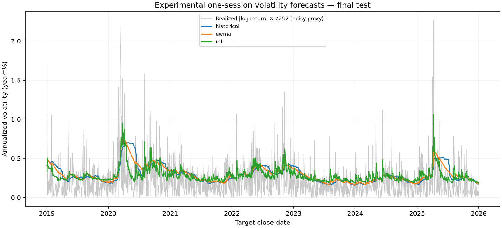
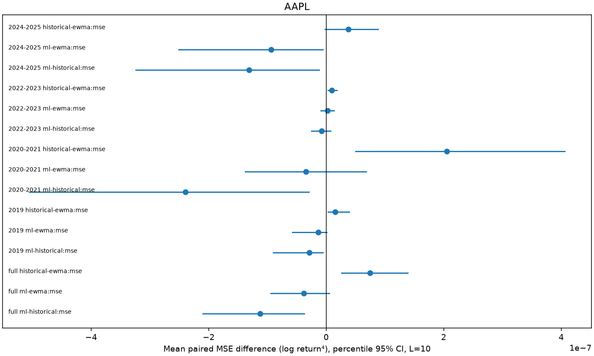
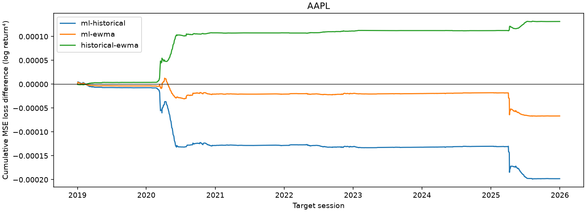
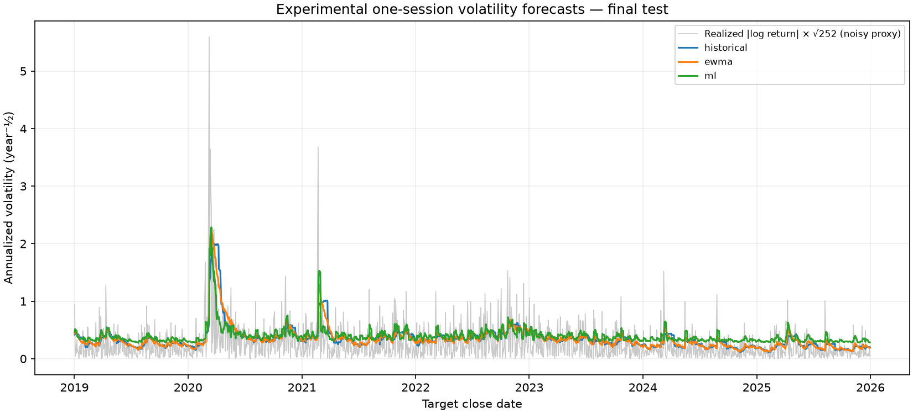
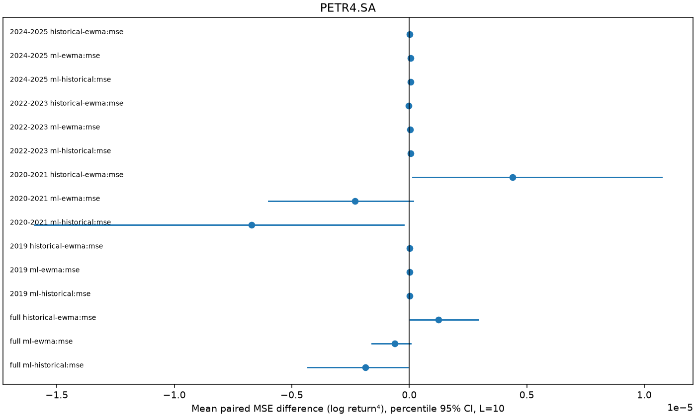
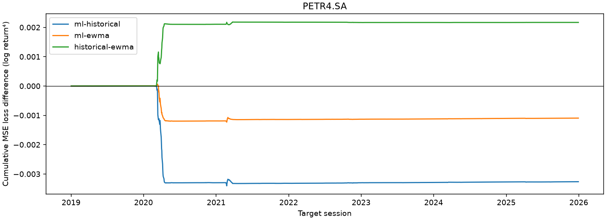
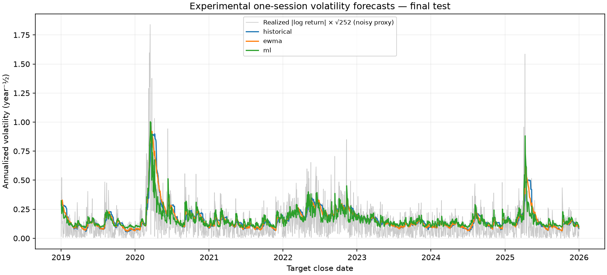
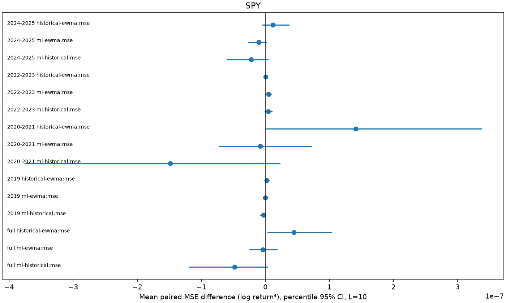
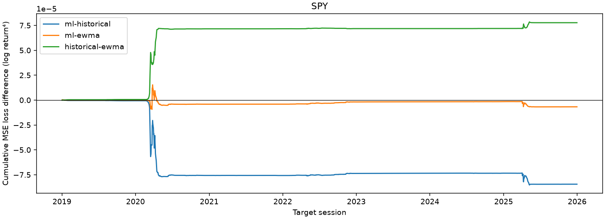

# Frozen volatility experiment

See [protocol](../protocol.md) and [manifest](../manifest.json) for design, source, hashes and code identity.
Validation scores select parameters; the following tables are final sequential test only.
Negative paired differences favor the first model. No cross-asset currency aggregation.

## AAPL
Selected only on validation: {'historical_window': 63, 'ewma_factor': 0.97}

|Period|n|Model|MSE|MAE|Pinball (currency)|VaR violations / nominal 5%|Wilson 95%|
|---|---:|---|---:|---:|---:|---|---|
|full|1760|historical|1.265017e-06|0.0004575362|0.3055125|81 (4.60%)|{'method': 'wilson_score', 'confidence_level': 0.95, 'lower': 0.03718305518097033, 'upper': 0.056839827653168196, 'assumptions': 'Independent Bernoulli violations with a constant probability, conditional on the fitted model.', 'limitations': 'Small samples give wide intervals and approximate coverage; zero violations do not establish zero risk. Nonoverlapping horizons do not guarantee independence in market data. This estimates uncertainty in the observed violation rate, not the nominal rate 1-alpha or uncertainty in GBM parameters or model specification.'}|
|full|1760|ewma|1.190337e-06|0.0004396267|0.3006505|79 (4.49%)|{'method': 'wilson_score', 'confidence_level': 0.95, 'lower': 0.03616404731589771, 'upper': 0.05559105800343265, 'assumptions': 'Independent Bernoulli violations with a constant probability, conditional on the fitted model.', 'limitations': 'Small samples give wide intervals and approximate coverage; zero violations do not establish zero risk. Nonoverlapping horizons do not guarantee independence in market data. This estimates uncertainty in the observed violation rate, not the nominal rate 1-alpha or uncertainty in GBM parameters or model specification.'}|
|full|1760|ml|1.152516e-06|0.0004092602|0.2898368|85 (4.83%)|{'method': 'wilson_score', 'confidence_level': 0.95, 'lower': 0.03922584544500998, 'upper': 0.059332592418744876, 'assumptions': 'Independent Bernoulli violations with a constant probability, conditional on the fitted model.', 'limitations': 'Small samples give wide intervals and approximate coverage; zero violations do not establish zero risk. Nonoverlapping horizons do not guarantee independence in market data. This estimates uncertainty in the observed violation rate, not the nominal rate 1-alpha or uncertainty in GBM parameters or model specification.'}|

full: lowest losses {'mse': 'ml', 'mae': 'ml', 'quantile_loss': 'ml'}.

|Pair (MSE)|Mean|Relative to second MSE|L=5 CI|L=10 CI|L=20 CI|
|---|---:|---:|---|---|---|
|ml-historical|-1.12501e-07|-0.08893247928185725|[-1.97092e-07, -4.66102e-08] excludes zero|[-2.10294e-07, -3.70308e-08] excludes zero|[-2.22564e-07, -3.01398e-08] excludes zero|
|ml-ewma|-3.78215e-08|-0.03177379522431588|[-9.00063e-08, 1.98174e-10] crosses zero|[-9.4507e-08, 5.10321e-09] crosses zero|[-9.77814e-08, 7.27259e-09] crosses zero|
|historical-ewma|7.46795e-08|0.06273814262688943|[3.56349e-08, 1.29661e-07] excludes zero|[2.61097e-08, 1.39044e-07] excludes zero|[2.00753e-08, 1.52803e-07] excludes zero|

All secondary paired intervals and violation-rate block intervals are in results.json.

|Period|n|Model|MSE|MAE|Pinball (currency)|VaR violations / nominal 5%|Wilson 95%|
|---|---:|---|---:|---:|---:|---|---|
|2019|252|historical|7.238792e-07|0.0003892961|0.1055794|7 (2.78%)|{'method': 'wilson_score', 'confidence_level': 0.95, 'lower': 0.013519385168063443, 'upper': 0.05621700119767514, 'assumptions': 'Independent Bernoulli violations with a constant probability, conditional on the fitted model.', 'limitations': 'Small samples give wide intervals and approximate coverage; zero violations do not establish zero risk. Nonoverlapping horizons do not guarantee independence in market data. This estimates uncertainty in the observed violation rate, not the nominal rate 1-alpha or uncertainty in GBM parameters or model specification.'}|
|2019|252|ewma|7.08661e-07|0.0003734364|0.1011697|7 (2.78%)|{'method': 'wilson_score', 'confidence_level': 0.95, 'lower': 0.013519385168063443, 'upper': 0.05621700119767514, 'assumptions': 'Independent Bernoulli violations with a constant probability, conditional on the fitted model.', 'limitations': 'Small samples give wide intervals and approximate coverage; zero violations do not establish zero risk. Nonoverlapping horizons do not guarantee independence in market data. This estimates uncertainty in the observed violation rate, not the nominal rate 1-alpha or uncertainty in GBM parameters or model specification.'}|
|2019|252|ml|6.948495e-07|0.0003232893|0.09793693|7 (2.78%)|{'method': 'wilson_score', 'confidence_level': 0.95, 'lower': 0.013519385168063443, 'upper': 0.05621700119767514, 'assumptions': 'Independent Bernoulli violations with a constant probability, conditional on the fitted model.', 'limitations': 'Small samples give wide intervals and approximate coverage; zero violations do not establish zero risk. Nonoverlapping horizons do not guarantee independence in market data. This estimates uncertainty in the observed violation rate, not the nominal rate 1-alpha or uncertainty in GBM parameters or model specification.'}|

2019: lowest losses {'mse': 'ml', 'mae': 'ml', 'quantile_loss': 'ml'}.

|Pair (MSE)|Mean|Relative to second MSE|L=5 CI|L=10 CI|L=20 CI|
|---|---:|---:|---|---|---|
|ml-historical|-2.90297e-08|-0.040102940910160915|[-8.04408e-08, 2.96525e-09] crosses zero|[-9.0202e-08, -5.45542e-09] excludes zero|[-9.90532e-08, -3.99575e-09] excludes zero|
|ml-ewma|-1.38115e-08|-0.01948963495851015|[-5.14072e-08, 8.45349e-09] crosses zero|[-5.74778e-08, 8.37411e-10] crosses zero|[-5.52347e-08, -5.77234e-10] excludes zero|
|historical-ewma|1.52181e-08|0.02147449641235073|[1.68119e-09, 3.39e-08] excludes zero|[2.71408e-09, 3.93389e-08] excludes zero|[1.01145e-09, 4.46197e-08] excludes zero|

All secondary paired intervals and violation-rate block intervals are in results.json.

|Period|n|Model|MSE|MAE|Pinball (currency)|VaR violations / nominal 5%|Wilson 95%|
|---|---:|---|---:|---:|---:|---|---|
|2020-2021|505|historical|2.358314e-06|0.0006680789|0.2810687|27 (5.35%)|{'method': 'wilson_score', 'confidence_level': 0.95, 'lower': 0.03700170101268771, 'upper': 0.07667114898414468, 'assumptions': 'Independent Bernoulli violations with a constant probability, conditional on the fitted model.', 'limitations': 'Small samples give wide intervals and approximate coverage; zero violations do not establish zero risk. Nonoverlapping horizons do not guarantee independence in market data. This estimates uncertainty in the observed violation rate, not the nominal rate 1-alpha or uncertainty in GBM parameters or model specification.'}|
|2020-2021|505|ewma|2.152937e-06|0.0006324249|0.2757524|28 (5.54%)|{'method': 'wilson_score', 'confidence_level': 0.95, 'lower': 0.03863643349264166, 'upper': 0.07896691384345089, 'assumptions': 'Independent Bernoulli violations with a constant probability, conditional on the fitted model.', 'limitations': 'Small samples give wide intervals and approximate coverage; zero violations do not establish zero risk. Nonoverlapping horizons do not guarantee independence in market data. This estimates uncertainty in the observed violation rate, not the nominal rate 1-alpha or uncertainty in GBM parameters or model specification.'}|
|2020-2021|505|ml|2.118746e-06|0.0005683004|0.2709424|33 (6.53%)|{'method': 'wilson_score', 'confidence_level': 0.95, 'lower': 0.0469056078773359, 'upper': 0.09035022615505749, 'assumptions': 'Independent Bernoulli violations with a constant probability, conditional on the fitted model.', 'limitations': 'Small samples give wide intervals and approximate coverage; zero violations do not establish zero risk. Nonoverlapping horizons do not guarantee independence in market data. This estimates uncertainty in the observed violation rate, not the nominal rate 1-alpha or uncertainty in GBM parameters or model specification.'}|

2020-2021: lowest losses {'mse': 'ml', 'mae': 'ml', 'quantile_loss': 'ml'}.

|Pair (MSE)|Mean|Relative to second MSE|L=5 CI|L=10 CI|L=20 CI|
|---|---:|---:|---|---|---|
|ml-historical|-2.39568e-07|-0.1015842976084138|[-4.60116e-07, -5.53592e-08] excludes zero|[-5.05298e-07, -2.95392e-08] excludes zero|[-5.84274e-07, -4.56921e-09] excludes zero|
|ml-ewma|-3.41911e-08|-0.01588116115784735|[-1.2194e-07, 6.32591e-08] crosses zero|[-1.37953e-07, 6.78549e-08] crosses zero|[-1.69559e-07, 6.90798e-08] crosses zero|
|historical-ewma|2.05377e-07|0.0953936315031275|[7.60264e-08, 3.68818e-07] excludes zero|[5.02918e-08, 4.06012e-07] excludes zero|[2.60375e-08, 4.59828e-07] excludes zero|

All secondary paired intervals and violation-rate block intervals are in results.json.

|Period|n|Model|MSE|MAE|Pinball (currency)|VaR violations / nominal 5%|Wilson 95%|
|---|---:|---|---:|---:|---:|---|---|
|2022-2023|501|historical|4.163351e-07|0.0003504591|0.29938|19 (3.79%)|{'method': 'wilson_score', 'confidence_level': 0.95, 'lower': 0.024411029188425814, 'upper': 0.058469364427493634, 'assumptions': 'Independent Bernoulli violations with a constant probability, conditional on the fitted model.', 'limitations': 'Small samples give wide intervals and approximate coverage; zero violations do not establish zero risk. Nonoverlapping horizons do not guarantee independence in market data. This estimates uncertainty in the observed violation rate, not the nominal rate 1-alpha or uncertainty in GBM parameters or model specification.'}|
|2022-2023|501|ewma|4.06596e-07|0.0003462674|0.2946015|19 (3.79%)|{'method': 'wilson_score', 'confidence_level': 0.95, 'lower': 0.024411029188425814, 'upper': 0.058469364427493634, 'assumptions': 'Independent Bernoulli violations with a constant probability, conditional on the fitted model.', 'limitations': 'Small samples give wide intervals and approximate coverage; zero violations do not establish zero risk. Nonoverlapping horizons do not guarantee independence in market data. This estimates uncertainty in the observed violation rate, not the nominal rate 1-alpha or uncertainty in GBM parameters or model specification.'}|
|2022-2023|501|ml|4.088993e-07|0.0003445383|0.2892089|20 (3.99%)|{'method': 'wilson_score', 'confidence_level': 0.95, 'lower': 0.025988524929227916, 'upper': 0.060853508455089286, 'assumptions': 'Independent Bernoulli violations with a constant probability, conditional on the fitted model.', 'limitations': 'Small samples give wide intervals and approximate coverage; zero violations do not establish zero risk. Nonoverlapping horizons do not guarantee independence in market data. This estimates uncertainty in the observed violation rate, not the nominal rate 1-alpha or uncertainty in GBM parameters or model specification.'}|

2022-2023: lowest losses {'mse': 'ewma', 'mae': 'ml', 'quantile_loss': 'ml'}.

|Pair (MSE)|Mean|Relative to second MSE|L=5 CI|L=10 CI|L=20 CI|
|---|---:|---:|---|---|---|
|ml-historical|-7.43577e-09|-0.017860070030549294|[-2.30906e-08, 7.41216e-09] crosses zero|[-2.48648e-08, 7.58805e-09] crosses zero|[-2.51908e-08, 6.80486e-09] crosses zero|
|ml-ewma|2.30327e-09|0.005664773613593274|[-9.28245e-09, 1.42467e-08] crosses zero|[-9.24863e-09, 1.34918e-08] crosses zero|[-9.23949e-09, 1.24624e-08] crosses zero|
|historical-ewma|9.73905e-09|0.02395263946235676|[3.25985e-09, 1.65866e-08] excludes zero|[2.82697e-09, 1.80495e-08] excludes zero|[3.01285e-09, 1.89745e-08] excludes zero|

All secondary paired intervals and violation-rate block intervals are in results.json.

|Period|n|Model|MSE|MAE|Pinball (currency)|VaR violations / nominal 5%|Wilson 95%|
|---|---:|---|---:|---:|---:|---|---|
|2024-2025|502|historical|1.283824e-06|0.0003868551|0.4365874|28 (5.58%)|{'method': 'wilson_score', 'confidence_level': 0.95, 'lower': 0.03886900861334169, 'upper': 0.0794318103037296, 'assumptions': 'Independent Bernoulli violations with a constant probability, conditional on the fitted model.', 'limitations': 'Small samples give wide intervals and approximate coverage; zero violations do not establish zero risk. Nonoverlapping horizons do not guarantee independence in market data. This estimates uncertainty in the observed violation rate, not the nominal rate 1-alpha or uncertainty in GBM parameters or model specification.'}|
|2024-2025|502|ewma|1.245962e-06|0.0003720767|0.431872|25 (4.98%)|{'method': 'wilson_score', 'confidence_level': 0.95, 'lower': 0.0339570043317698, 'upper': 0.07248239062454462, 'assumptions': 'Independent Bernoulli violations with a constant probability, conditional on the fitted model.', 'limitations': 'Small samples give wide intervals and approximate coverage; zero violations do not establish zero risk. Nonoverlapping horizons do not guarantee independence in market data. This estimates uncertainty in the observed violation rate, not the nominal rate 1-alpha or uncertainty in GBM parameters or model specification.'}|
|2024-2025|502|ml|1.15239e-06|0.000357019|0.4058028|25 (4.98%)|{'method': 'wilson_score', 'confidence_level': 0.95, 'lower': 0.0339570043317698, 'upper': 0.07248239062454462, 'assumptions': 'Independent Bernoulli violations with a constant probability, conditional on the fitted model.', 'limitations': 'Small samples give wide intervals and approximate coverage; zero violations do not establish zero risk. Nonoverlapping horizons do not guarantee independence in market data. This estimates uncertainty in the observed violation rate, not the nominal rate 1-alpha or uncertainty in GBM parameters or model specification.'}|

2024-2025: lowest losses {'mse': 'ml', 'mae': 'ml', 'quantile_loss': 'ml'}.

|Pair (MSE)|Mean|Relative to second MSE|L=5 CI|L=10 CI|L=20 CI|
|---|---:|---:|---|---|---|
|ml-historical|-1.31433e-07|-0.10237628779778497|[-3.41201e-07, -1.12068e-08] excludes zero|[-3.23774e-07, -1.2291e-08] excludes zero|[-3.42414e-07, -4.12429e-09] excludes zero|
|ml-ewma|-9.35713e-08|-0.07509965829656766|[-2.57434e-07, 1.64769e-09] crosses zero|[-2.5084e-07, -5.43319e-09] excludes zero|[-2.66612e-07, -6.88041e-10] excludes zero|
|historical-ewma|3.78618e-08|0.030387599091268754|[3.17426e-09, 8.32621e-08] excludes zero|[-1.82328e-09, 8.8597e-08] crosses zero|[-1.26384e-09, 9.40036e-08] crosses zero|

All secondary paired intervals and violation-rate block intervals are in results.json.

## PETR4.SA
Selected only on validation: {'historical_window': 22, 'ewma_factor': 0.9}

|Period|n|Model|MSE|MAE|Pinball (currency)|VaR violations / nominal 5%|Wilson 95%|
|---|---:|---|---:|---:|---:|---|---|
|full|1742|historical|1.471957e-05|0.0008029824|0.03798335|89 (5.11%)|{'method': 'wilson_score', 'confidence_level': 0.95, 'lower': 0.041703029066920916, 'upper': 0.0624538850113637, 'assumptions': 'Independent Bernoulli violations with a constant probability, conditional on the fitted model.', 'limitations': 'Small samples give wide intervals and approximate coverage; zero violations do not establish zero risk. Nonoverlapping horizons do not guarantee independence in market data. This estimates uncertainty in the observed violation rate, not the nominal rate 1-alpha or uncertainty in GBM parameters or model specification.'}|
|full|1742|ewma|1.347438e-05|0.0007571262|0.0378594|84 (4.82%)|{'method': 'wilson_score', 'confidence_level': 0.95, 'lower': 0.03911630824311064, 'upper': 0.05931270886636506, 'assumptions': 'Independent Bernoulli violations with a constant probability, conditional on the fitted model.', 'limitations': 'Small samples give wide intervals and approximate coverage; zero violations do not establish zero risk. Nonoverlapping horizons do not guarantee independence in market data. This estimates uncertainty in the observed violation rate, not the nominal rate 1-alpha or uncertainty in GBM parameters or model specification.'}|
|full|1742|ml|1.284593e-05|0.0007804595|0.03894636|60 (3.44%)|{'method': 'wilson_score', 'confidence_level': 0.95, 'lower': 0.02685210549256127, 'upper': 0.04408300616663159, 'assumptions': 'Independent Bernoulli violations with a constant probability, conditional on the fitted model.', 'limitations': 'Small samples give wide intervals and approximate coverage; zero violations do not establish zero risk. Nonoverlapping horizons do not guarantee independence in market data. This estimates uncertainty in the observed violation rate, not the nominal rate 1-alpha or uncertainty in GBM parameters or model specification.'}|

full: lowest losses {'mse': 'ml', 'mae': 'ewma', 'quantile_loss': 'ewma'}.

|Pair (MSE)|Mean|Relative to second MSE|L=5 CI|L=10 CI|L=20 CI|
|---|---:|---:|---|---|---|
|ml-historical|-1.87365e-06|-0.1272895671725057|[-3.86984e-06, -4.1052e-07] excludes zero|[-4.33225e-06, -7.22644e-08] excludes zero|[-5.04996e-06, 8.13236e-08] crosses zero|
|ml-ewma|-6.28456e-07|-0.04664078048202371|[-1.41371e-06, -4.12198e-08] excludes zero|[-1.59227e-06, 5.89615e-08] crosses zero|[-1.9196e-06, 1.05731e-07] crosses zero|
|historical-ewma|1.24519e-06|0.0924118512359111|[1.03936e-07, 2.87077e-06] excludes zero|[4.59026e-08, 2.94087e-06] excludes zero|[-5.92291e-10, 3.23447e-06] crosses zero|

All secondary paired intervals and violation-rate block intervals are in results.json.

|Period|n|Model|MSE|MAE|Pinball (currency)|VaR violations / nominal 5%|Wilson 95%|
|---|---:|---|---:|---:|---:|---|---|
|2019|248|historical|4.418229e-07|0.0003857963|0.01533935|16 (6.45%)|{'method': 'wilson_score', 'confidence_level': 0.95, 'lower': 0.04009866723027725, 'upper': 0.1022188804385222, 'assumptions': 'Independent Bernoulli violations with a constant probability, conditional on the fitted model.', 'limitations': 'Small samples give wide intervals and approximate coverage; zero violations do not establish zero risk. Nonoverlapping horizons do not guarantee independence in market data. This estimates uncertainty in the observed violation rate, not the nominal rate 1-alpha or uncertainty in GBM parameters or model specification.'}|
|2019|248|ewma|4.356891e-07|0.0003801437|0.01493057|12 (4.84%)|{'method': 'wilson_score', 'confidence_level': 0.95, 'lower': 0.027893065503021345, 'upper': 0.08265846541277067, 'assumptions': 'Independent Bernoulli violations with a constant probability, conditional on the fitted model.', 'limitations': 'Small samples give wide intervals and approximate coverage; zero violations do not establish zero risk. Nonoverlapping horizons do not guarantee independence in market data. This estimates uncertainty in the observed violation rate, not the nominal rate 1-alpha or uncertainty in GBM parameters or model specification.'}|
|2019|248|ml|4.571101e-07|0.0004566372|0.01528792|4 (1.61%)|{'method': 'wilson_score', 'confidence_level': 0.95, 'lower': 0.0062896810596302505, 'upper': 0.04072981635014689, 'assumptions': 'Independent Bernoulli violations with a constant probability, conditional on the fitted model.', 'limitations': 'Small samples give wide intervals and approximate coverage; zero violations do not establish zero risk. Nonoverlapping horizons do not guarantee independence in market data. This estimates uncertainty in the observed violation rate, not the nominal rate 1-alpha or uncertainty in GBM parameters or model specification.'}|

2019: lowest losses {'mse': 'ewma', 'mae': 'ewma', 'quantile_loss': 'ewma'}.

|Pair (MSE)|Mean|Relative to second MSE|L=5 CI|L=10 CI|L=20 CI|
|---|---:|---:|---|---|---|
|ml-historical|1.52872e-08|0.034600292211715705|[-1.26633e-08, 4.35393e-08] crosses zero|[-1.0384e-08, 3.85445e-08] crosses zero|[-5.46814e-09, 3.5477e-08] crosses zero|
|ml-ewma|2.1421e-08|0.04916580112593035|[3.57907e-09, 4.02822e-08] excludes zero|[5.39421e-09, 3.71762e-08] excludes zero|[5.09233e-09, 3.81102e-08] excludes zero|
|historical-ewma|6.1338e-09|0.014078392422524112|[-1.17267e-08, 2.32404e-08] crosses zero|[-9.23949e-09, 2.30373e-08] crosses zero|[-5.66024e-09, 1.82691e-08] crosses zero|

All secondary paired intervals and violation-rate block intervals are in results.json.

|Period|n|Model|MSE|MAE|Pinball (currency)|VaR violations / nominal 5%|Wilson 95%|
|---|---:|---|---:|---:|---:|---|---|
|2020-2021|495|historical|5.010149e-05|0.001751014|0.02704084|25 (5.05%)|{'method': 'wilson_score', 'confidence_level': 0.95, 'lower': 0.034440465036702075, 'upper': 0.07349254227183269, 'assumptions': 'Independent Bernoulli violations with a constant probability, conditional on the fitted model.', 'limitations': 'Small samples give wide intervals and approximate coverage; zero violations do not establish zero risk. Nonoverlapping horizons do not guarantee independence in market data. This estimates uncertainty in the observed violation rate, not the nominal rate 1-alpha or uncertainty in GBM parameters or model specification.'}|
|2020-2021|495|ewma|4.570586e-05|0.001594048|0.02623479|24 (4.85%)|{'method': 'wilson_score', 'confidence_level': 0.95, 'lower': 0.032795298559394837, 'upper': 0.07112841889434683, 'assumptions': 'Independent Bernoulli violations with a constant probability, conditional on the fitted model.', 'limitations': 'Small samples give wide intervals and approximate coverage; zero violations do not establish zero risk. Nonoverlapping horizons do not guarantee independence in market data. This estimates uncertainty in the observed violation rate, not the nominal rate 1-alpha or uncertainty in GBM parameters or model specification.'}|
|2020-2021|495|ml|4.338958e-05|0.001423387|0.02527909|23 (4.65%)|{'method': 'wilson_score', 'confidence_level': 0.95, 'lower': 0.03115866331498351, 'upper': 0.06875576428396504, 'assumptions': 'Independent Bernoulli violations with a constant probability, conditional on the fitted model.', 'limitations': 'Small samples give wide intervals and approximate coverage; zero violations do not establish zero risk. Nonoverlapping horizons do not guarantee independence in market data. This estimates uncertainty in the observed violation rate, not the nominal rate 1-alpha or uncertainty in GBM parameters or model specification.'}|

2020-2021: lowest losses {'mse': 'ml', 'mae': 'ml', 'quantile_loss': 'ml'}.

|Pair (MSE)|Mean|Relative to second MSE|L=5 CI|L=10 CI|L=20 CI|
|---|---:|---:|---|---|---|
|ml-historical|-6.71191e-06|-0.1339663187040718|[-1.38841e-05, -1.34092e-06] excludes zero|[-1.596e-05, -2.4857e-07] excludes zero|[-1.75787e-05, 1.42501e-07] crosses zero|
|ml-ewma|-2.31628e-06|-0.05067792375820102|[-5.13051e-06, -2.51222e-07] excludes zero|[-5.98856e-06, 1.64785e-07] crosses zero|[-6.85154e-06, 2.69146e-07] crosses zero|
|historical-ewma|4.39563e-06|0.09617223526599852|[1.60347e-07, 9.78746e-06] excludes zero|[1.4257e-07, 1.07421e-05] excludes zero|[4.65575e-08, 1.10734e-05] excludes zero|

All secondary paired intervals and violation-rate block intervals are in results.json.

|Period|n|Model|MSE|MAE|Pinball (currency)|VaR violations / nominal 5%|Wilson 95%|
|---|---:|---|---:|---:|---:|---|---|
|2022-2023|498|historical|1.061722e-06|0.0006014047|0.04323585|25 (5.02%)|{'method': 'wilson_score', 'confidence_level': 0.95, 'lower': 0.034231591981612144, 'upper': 0.0730561935816198, 'assumptions': 'Independent Bernoulli violations with a constant probability, conditional on the fitted model.', 'limitations': 'Small samples give wide intervals and approximate coverage; zero violations do not establish zero risk. Nonoverlapping horizons do not guarantee independence in market data. This estimates uncertainty in the observed violation rate, not the nominal rate 1-alpha or uncertainty in GBM parameters or model specification.'}|
|2022-2023|498|ewma|1.082604e-06|0.000602611|0.04416378|24 (4.82%)|{'method': 'wilson_score', 'confidence_level': 0.95, 'lower': 0.03259644291632387, 'upper': 0.07070602026102965, 'assumptions': 'Independent Bernoulli violations with a constant probability, conditional on the fitted model.', 'limitations': 'Small samples give wide intervals and approximate coverage; zero violations do not establish zero risk. Nonoverlapping horizons do not guarantee independence in market data. This estimates uncertainty in the observed violation rate, not the nominal rate 1-alpha or uncertainty in GBM parameters or model specification.'}|
|2022-2023|498|ml|1.12056e-06|0.0006677703|0.04450882|21 (4.22%)|{'method': 'wilson_score', 'confidence_level': 0.95, 'lower': 0.02774394045098236, 'upper': 0.06360255556873587, 'assumptions': 'Independent Bernoulli violations with a constant probability, conditional on the fitted model.', 'limitations': 'Small samples give wide intervals and approximate coverage; zero violations do not establish zero risk. Nonoverlapping horizons do not guarantee independence in market data. This estimates uncertainty in the observed violation rate, not the nominal rate 1-alpha or uncertainty in GBM parameters or model specification.'}|

2022-2023: lowest losses {'mse': 'historical', 'mae': 'historical', 'quantile_loss': 'historical'}.

|Pair (MSE)|Mean|Relative to second MSE|L=5 CI|L=10 CI|L=20 CI|
|---|---:|---:|---|---|---|
|ml-historical|5.88378e-08|0.05541732780666649|[1.82736e-08, 1.0243e-07] excludes zero|[2.68191e-08, 9.33368e-08] excludes zero|[2.96568e-08, 9.03663e-08] excludes zero|
|ml-ewma|3.79557e-08|0.03505963331686949|[3.8957e-09, 6.88368e-08] excludes zero|[7.6867e-09, 6.44691e-08] excludes zero|[7.17456e-09, 6.25916e-08] excludes zero|
|historical-ewma|-2.08821e-08|-0.019288762798791347|[-4.47985e-08, 1.21169e-10] crosses zero|[-4.7065e-08, -9.49048e-11] excludes zero|[-5.12566e-08, 1.71788e-10] crosses zero|

All secondary paired intervals and violation-rate block intervals are in results.json.

|Period|n|Model|MSE|MAE|Pinball (currency)|VaR violations / nominal 5%|Wilson 95%|
|---|---:|---|---:|---:|---:|---|---|
|2024-2025|501|historical|4.050914e-07|0.0002731862|0.05478275|23 (4.59%)|{'method': 'wilson_score', 'confidence_level': 0.95, 'lower': 0.030783153200789008, 'upper': 0.06794379948872148, 'assumptions': 'Independent Bernoulli violations with a constant probability, conditional on the fitted model.', 'limitations': 'Small samples give wide intervals and approximate coverage; zero violations do not establish zero risk. Nonoverlapping horizons do not guarantee independence in market data. This estimates uncertainty in the observed violation rate, not the nominal rate 1-alpha or uncertainty in GBM parameters or model specification.'}|
|2024-2025|501|ewma|4.00771e-07|0.0002704272|0.05442816|24 (4.79%)|{'method': 'wilson_score', 'confidence_level': 0.95, 'lower': 0.03239998446358637, 'upper': 0.07028860799432186, 'assumptions': 'Independent Bernoulli violations with a constant probability, conditional on the fitted model.', 'limitations': 'Small samples give wide intervals and approximate coverage; zero violations do not establish zero risk. Nonoverlapping horizons do not guarantee independence in market data. This estimates uncertainty in the observed violation rate, not the nominal rate 1-alpha or uncertainty in GBM parameters or model specification.'}|
|2024-2025|501|ml|4.558078e-07|0.0004175411|0.05863196|12 (2.40%)|{'method': 'wilson_score', 'confidence_level': 0.95, 'lower': 0.013753702891983565, 'upper': 0.0413952123451516, 'assumptions': 'Independent Bernoulli violations with a constant probability, conditional on the fitted model.', 'limitations': 'Small samples give wide intervals and approximate coverage; zero violations do not establish zero risk. Nonoverlapping horizons do not guarantee independence in market data. This estimates uncertainty in the observed violation rate, not the nominal rate 1-alpha or uncertainty in GBM parameters or model specification.'}|

2024-2025: lowest losses {'mse': 'ewma', 'mae': 'ewma', 'quantile_loss': 'ewma'}.

|Pair (MSE)|Mean|Relative to second MSE|L=5 CI|L=10 CI|L=20 CI|
|---|---:|---:|---|---|---|
|ml-historical|5.07164e-08|0.12519751610564572|[1.19516e-08, 8.5658e-08] excludes zero|[1.6469e-08, 8.12848e-08] excludes zero|[1.54004e-08, 7.74331e-08] excludes zero|
|ml-ewma|5.50368e-08|0.137327290683742|[2.53574e-08, 8.25614e-08] excludes zero|[3.0334e-08, 7.69823e-08] excludes zero|[2.88985e-08, 7.41307e-08] excludes zero|
|historical-ewma|4.32036e-09|0.010780129181299591|[-7.25161e-09, 1.77637e-08] crosses zero|[-6.55741e-09, 1.73202e-08] crosses zero|[-6.54576e-09, 1.69744e-08] crosses zero|

All secondary paired intervals and violation-rate block intervals are in results.json.

## SPY
Selected only on validation: {'historical_window': 22, 'ewma_factor': 0.9}

|Period|n|Model|MSE|MAE|Pinball (currency)|VaR violations / nominal 5%|Wilson 95%|
|---|---:|---|---:|---:|---:|---|---|
|full|1760|historical|3.512085e-07|0.0001748088|0.5414224|102 (5.80%)|{'method': 'wilson_score', 'confidence_level': 0.95, 'lower': 0.047970551612447766, 'upper': 0.06986399512717649, 'assumptions': 'Independent Bernoulli violations with a constant probability, conditional on the fitted model.', 'limitations': 'Small samples give wide intervals and approximate coverage; zero violations do not establish zero risk. Nonoverlapping horizons do not guarantee independence in market data. This estimates uncertainty in the observed violation rate, not the nominal rate 1-alpha or uncertainty in GBM parameters or model specification.'}|
|full|1760|ewma|3.070403e-07|0.000167177|0.5272934|107 (6.08%)|{'method': 'wilson_score', 'confidence_level': 0.95, 'lower': 0.05055952859832717, 'upper': 0.0729444619283175, 'assumptions': 'Independent Bernoulli violations with a constant probability, conditional on the fitted model.', 'limitations': 'Small samples give wide intervals and approximate coverage; zero violations do not establish zero risk. Nonoverlapping horizons do not guarantee independence in market data. This estimates uncertainty in the observed violation rate, not the nominal rate 1-alpha or uncertainty in GBM parameters or model specification.'}|
|full|1760|ml|3.03205e-07|0.0001620407|0.512529|107 (6.08%)|{'method': 'wilson_score', 'confidence_level': 0.95, 'lower': 0.05055952859832717, 'upper': 0.0729444619283175, 'assumptions': 'Independent Bernoulli violations with a constant probability, conditional on the fitted model.', 'limitations': 'Small samples give wide intervals and approximate coverage; zero violations do not establish zero risk. Nonoverlapping horizons do not guarantee independence in market data. This estimates uncertainty in the observed violation rate, not the nominal rate 1-alpha or uncertainty in GBM parameters or model specification.'}|

full: lowest losses {'mse': 'ml', 'mae': 'ml', 'quantile_loss': 'ml'}.

|Pair (MSE)|Mean|Relative to second MSE|L=5 CI|L=10 CI|L=20 CI|
|---|---:|---:|---|---|---|
|ml-historical|-4.80035e-08|-0.1366808540798466|[-1.20697e-07, 1.02225e-08] crosses zero|[-1.1911e-07, 3.31623e-09] crosses zero|[-1.19579e-07, -2.33696e-09] excludes zero|
|ml-ewma|-3.8353e-09|-0.012491193424382858|[-2.76555e-08, 2.52656e-08] crosses zero|[-2.43506e-08, 1.76541e-08] crosses zero|[-2.28165e-08, 1.25897e-08] crosses zero|
|historical-ewma|4.41682e-08|0.14385139173891295|[5.0395e-09, 1.00234e-07] excludes zero|[4.0704e-09, 1.02464e-07] excludes zero|[2.16828e-09, 1.09464e-07] excludes zero|

All secondary paired intervals and violation-rate block intervals are in results.json.

|Period|n|Model|MSE|MAE|Pinball (currency)|VaR violations / nominal 5%|Wilson 95%|
|---|---:|---|---:|---:|---:|---|---|
|2019|252|historical|2.127726e-08|8.243948e-05|0.283484|13 (5.16%)|{'method': 'wilson_score', 'confidence_level': 0.95, 'lower': 0.030392512364935453, 'upper': 0.08624792174706841, 'assumptions': 'Independent Bernoulli violations with a constant probability, conditional on the fitted model.', 'limitations': 'Small samples give wide intervals and approximate coverage; zero violations do not establish zero risk. Nonoverlapping horizons do not guarantee independence in market data. This estimates uncertainty in the observed violation rate, not the nominal rate 1-alpha or uncertainty in GBM parameters or model specification.'}|
|2019|252|ewma|1.898623e-08|7.548526e-05|0.2678403|13 (5.16%)|{'method': 'wilson_score', 'confidence_level': 0.95, 'lower': 0.030392512364935453, 'upper': 0.08624792174706841, 'assumptions': 'Independent Bernoulli violations with a constant probability, conditional on the fitted model.', 'limitations': 'Small samples give wide intervals and approximate coverage; zero violations do not establish zero risk. Nonoverlapping horizons do not guarantee independence in market data. This estimates uncertainty in the observed violation rate, not the nominal rate 1-alpha or uncertainty in GBM parameters or model specification.'}|
|2019|252|ml|1.86055e-08|7.517871e-05|0.262593|9 (3.57%)|{'method': 'wilson_score', 'confidence_level': 0.95, 'lower': 0.018901160789733903, 'upper': 0.06646990815809312, 'assumptions': 'Independent Bernoulli violations with a constant probability, conditional on the fitted model.', 'limitations': 'Small samples give wide intervals and approximate coverage; zero violations do not establish zero risk. Nonoverlapping horizons do not guarantee independence in market data. This estimates uncertainty in the observed violation rate, not the nominal rate 1-alpha or uncertainty in GBM parameters or model specification.'}|

2019: lowest losses {'mse': 'ml', 'mae': 'ml', 'quantile_loss': 'ml'}.

|Pair (MSE)|Mean|Relative to second MSE|L=5 CI|L=10 CI|L=20 CI|
|---|---:|---:|---|---|---|
|ml-historical|-2.67175e-09|-0.12556840037599581|[-6.60135e-09, -3.75953e-10] excludes zero|[-7.41609e-09, -3.99061e-10] excludes zero|[-6.97272e-09, -3.65404e-10] excludes zero|
|ml-ewma|-3.80724e-10|-0.020052634120597868|[-2.95295e-09, 7.83594e-10] crosses zero|[-2.81421e-09, 3.22123e-10] crosses zero|[-2.30443e-09, 2.54477e-10] crosses zero|
|historical-ewma|2.29103e-09|0.1206678330252115|[6.414e-10, 4.5966e-09] excludes zero|[5.01696e-10, 5.2886e-09] excludes zero|[4.27345e-10, 4.96236e-09] excludes zero|

All secondary paired intervals and violation-rate block intervals are in results.json.

|Period|n|Model|MSE|MAE|Pinball (currency)|VaR violations / nominal 5%|Wilson 95%|
|---|---:|---|---:|---:|---:|---|---|
|2020-2021|505|historical|8.881528e-07|0.00028363|0.5626984|30 (5.94%)|{'method': 'wilson_score', 'confidence_level': 0.95, 'lower': 0.04192587610235115, 'upper': 0.08353846591226172, 'assumptions': 'Independent Bernoulli violations with a constant probability, conditional on the fitted model.', 'limitations': 'Small samples give wide intervals and approximate coverage; zero violations do not establish zero risk. Nonoverlapping horizons do not guarantee independence in market data. This estimates uncertainty in the observed violation rate, not the nominal rate 1-alpha or uncertainty in GBM parameters or model specification.'}|
|2020-2021|505|ewma|7.473548e-07|0.0002643974|0.544145|29 (5.74%)|{'method': 'wilson_score', 'confidence_level': 0.95, 'lower': 0.04027793044709284, 'upper': 0.08125591422825988, 'assumptions': 'Independent Bernoulli violations with a constant probability, conditional on the fitted model.', 'limitations': 'Small samples give wide intervals and approximate coverage; zero violations do not establish zero risk. Nonoverlapping horizons do not guarantee independence in market data. This estimates uncertainty in the observed violation rate, not the nominal rate 1-alpha or uncertainty in GBM parameters or model specification.'}|
|2020-2021|505|ml|7.394284e-07|0.0002430337|0.5183798|34 (6.73%)|{'method': 'wilson_score', 'confidence_level': 0.95, 'lower': 0.04857665370550827, 'upper': 0.09260967766614531, 'assumptions': 'Independent Bernoulli violations with a constant probability, conditional on the fitted model.', 'limitations': 'Small samples give wide intervals and approximate coverage; zero violations do not establish zero risk. Nonoverlapping horizons do not guarantee independence in market data. This estimates uncertainty in the observed violation rate, not the nominal rate 1-alpha or uncertainty in GBM parameters or model specification.'}|

2020-2021: lowest losses {'mse': 'ml', 'mae': 'ml', 'quantile_loss': 'ml'}.

|Pair (MSE)|Mean|Relative to second MSE|L=5 CI|L=10 CI|L=20 CI|
|---|---:|---:|---|---|---|
|ml-historical|-1.48724e-07|-0.16745358220879414|[-3.92858e-07, 6.52115e-08] crosses zero|[-3.75227e-07, 2.24017e-08] crosses zero|[-3.80688e-07, 1.02068e-09] crosses zero|
|ml-ewma|-7.92638e-09|-0.010605909481128056|[-9.12533e-08, 1.0493e-07] crosses zero|[-7.22218e-08, 7.21016e-08] crosses zero|[-6.96713e-08, 4.81869e-08] crosses zero|
|historical-ewma|1.40798e-07|0.18839510851994545|[3.25578e-09, 3.28966e-07] excludes zero|[2.40033e-09, 3.36639e-07] excludes zero|[-1.43598e-10, 3.51185e-07] crosses zero|

All secondary paired intervals and violation-rate block intervals are in results.json.

|Period|n|Model|MSE|MAE|Pinball (currency)|VaR violations / nominal 5%|Wilson 95%|
|---|---:|---|---:|---:|---:|---|---|
|2022-2023|501|historical|6.974369e-08|0.0001545419|0.5135788|31 (6.19%)|{'method': 'wilson_score', 'confidence_level': 0.95, 'lower': 0.04393065630805229, 'upper': 0.08648941452864023, 'assumptions': 'Independent Bernoulli violations with a constant probability, conditional on the fitted model.', 'limitations': 'Small samples give wide intervals and approximate coverage; zero violations do not establish zero risk. Nonoverlapping horizons do not guarantee independence in market data. This estimates uncertainty in the observed violation rate, not the nominal rate 1-alpha or uncertainty in GBM parameters or model specification.'}|
|2022-2023|501|ewma|6.949428e-08|0.0001551511|0.5021574|35 (6.99%)|{'method': 'wilson_score', 'confidence_level': 0.95, 'lower': 0.050657557255233215, 'upper': 0.09560907265505034, 'assumptions': 'Independent Bernoulli violations with a constant probability, conditional on the fitted model.', 'limitations': 'Small samples give wide intervals and approximate coverage; zero violations do not establish zero risk. Nonoverlapping horizons do not guarantee independence in market data. This estimates uncertainty in the observed violation rate, not the nominal rate 1-alpha or uncertainty in GBM parameters or model specification.'}|
|2022-2023|501|ml|7.432087e-08|0.0001599308|0.5023662|37 (7.39%)|{'method': 'wilson_score', 'confidence_level': 0.95, 'lower': 0.05405211375425234, 'upper': 0.10013779569282671, 'assumptions': 'Independent Bernoulli violations with a constant probability, conditional on the fitted model.', 'limitations': 'Small samples give wide intervals and approximate coverage; zero violations do not establish zero risk. Nonoverlapping horizons do not guarantee independence in market data. This estimates uncertainty in the observed violation rate, not the nominal rate 1-alpha or uncertainty in GBM parameters or model specification.'}|

2022-2023: lowest losses {'mse': 'ewma', 'mae': 'historical', 'quantile_loss': 'ewma'}.

|Pair (MSE)|Mean|Relative to second MSE|L=5 CI|L=10 CI|L=20 CI|
|---|---:|---:|---|---|---|
|ml-historical|4.57718e-09|0.06562860550483138|[-2.80049e-10, 9.88879e-09] crosses zero|[-4.7686e-10, 1.03153e-08] crosses zero|[2.44882e-10, 9.72462e-09] excludes zero|
|ml-ewma|4.82658e-09|0.06945296908505467|[1.44663e-09, 8.70707e-09] excludes zero|[1.23336e-09, 8.87243e-09] excludes zero|[1.57317e-09, 9.00041e-09] excludes zero|
|historical-ewma|2.49403e-10|0.003588833445787183|[-1.67802e-09, 2.45232e-09] crosses zero|[-1.9202e-09, 2.5437e-09] crosses zero|[-1.75472e-09, 2.28092e-09] crosses zero|

All secondary paired intervals and violation-rate block intervals are in results.json.

|Period|n|Model|MSE|MAE|Pinball (currency)|VaR violations / nominal 5%|Wilson 95%|
|---|---:|---|---:|---:|---:|---|---|
|2024-2025|502|historical|2.575823e-07|0.0001319326|0.6772903|28 (5.58%)|{'method': 'wilson_score', 'confidence_level': 0.95, 'lower': 0.03886900861334169, 'upper': 0.0794318103037296, 'assumptions': 'Independent Bernoulli violations with a constant probability, conditional on the fitted model.', 'limitations': 'Small samples give wide intervals and approximate coverage; zero violations do not establish zero risk. Nonoverlapping horizons do not guarantee independence in market data. This estimates uncertainty in the observed violation rate, not the nominal rate 1-alpha or uncertainty in GBM parameters or model specification.'}|
|2024-2025|502|ewma|2.457682e-07|0.0001274061|0.6656706|30 (5.98%)|{'method': 'wilson_score', 'confidence_level': 0.95, 'lower': 0.04217834656928649, 'upper': 0.08403008832162276, 'assumptions': 'Independent Bernoulli violations with a constant probability, conditional on the fitted model.', 'limitations': 'Small samples give wide intervals and approximate coverage; zero violations do not establish zero risk. Nonoverlapping horizons do not guarantee independence in market data. This estimates uncertainty in the observed violation rate, not the nominal rate 1-alpha or uncertainty in GBM parameters or model specification.'}|
|2024-2025|502|ml|2.356696e-07|0.0001262736|0.6422518|27 (5.38%)|{'method': 'wilson_score', 'confidence_level': 0.95, 'lower': 0.037224393321710056, 'upper': 0.07712261760844229, 'assumptions': 'Independent Bernoulli violations with a constant probability, conditional on the fitted model.', 'limitations': 'Small samples give wide intervals and approximate coverage; zero violations do not establish zero risk. Nonoverlapping horizons do not guarantee independence in market data. This estimates uncertainty in the observed violation rate, not the nominal rate 1-alpha or uncertainty in GBM parameters or model specification.'}|

2024-2025: lowest losses {'mse': 'ml', 'mae': 'ml', 'quantile_loss': 'ml'}.

|Pair (MSE)|Mean|Relative to second MSE|L=5 CI|L=10 CI|L=20 CI|
|---|---:|---:|---|---|---|
|ml-historical|-2.19128e-08|-0.08507085906981787|[-5.9874e-08, 9.91764e-09] crosses zero|[-6.00451e-08, 3.81145e-09] crosses zero|[-6.19586e-08, 4.06607e-10] crosses zero|
|ml-ewma|-1.00986e-08|-0.04108983380120068|[-3.00501e-08, 5.34644e-09] crosses zero|[-2.67648e-08, 9.14943e-10] crosses zero|[-3.01294e-08, 5.08808e-10] crosses zero|
|historical-ewma|1.18142e-08|0.04807041693294734|[-6.98864e-09, 3.4181e-08] crosses zero|[-4.1478e-09, 3.65104e-08] crosses zero|[-1.70966e-10, 3.36777e-08] crosses zero|

All secondary paired intervals and violation-rate block intervals are in results.json.

## Interpretation limits
Inspect period winners and cumulative losses for concentration; block sensitivity is shown without selecting favorable intervals. Conflicting metric winners imply different objectives. Smaller violation rates alone may reflect excessive conservatism.
Pointwise intervals crossing zero are inconclusive, not equivalence. Wilson assumes independence; blocks allow local temporal dependence under approximate stationarity. No multiplicity correction. Conditional on frozen data, fitted models and protocol; not full selection, estimation, revision or future-regime uncertainty. Current adjusted prices are not authenticated point-in-time data. These three assets do not establish general superiority or profitability.
